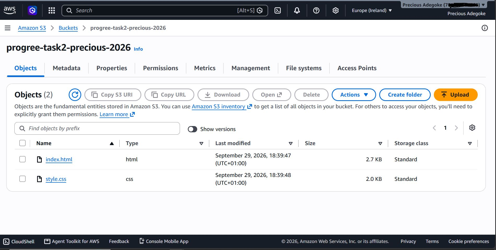
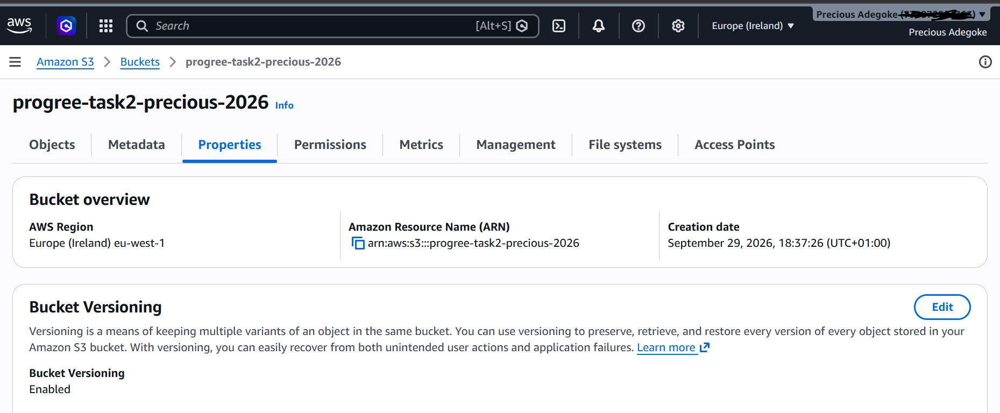
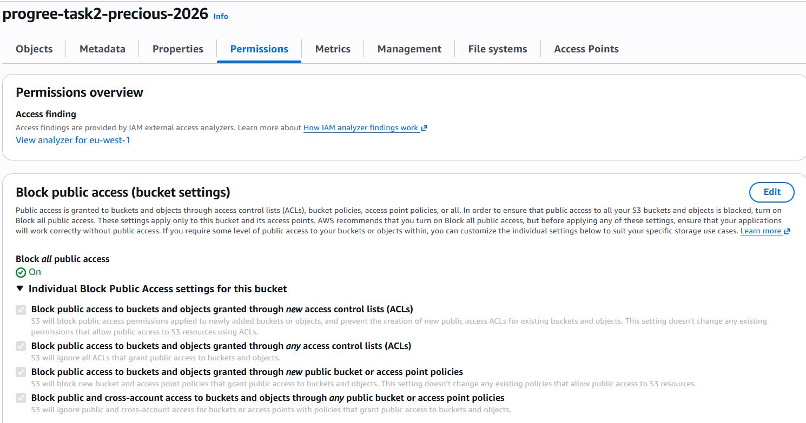
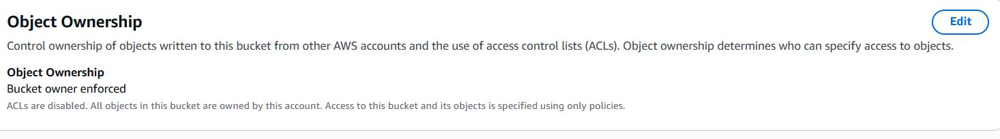
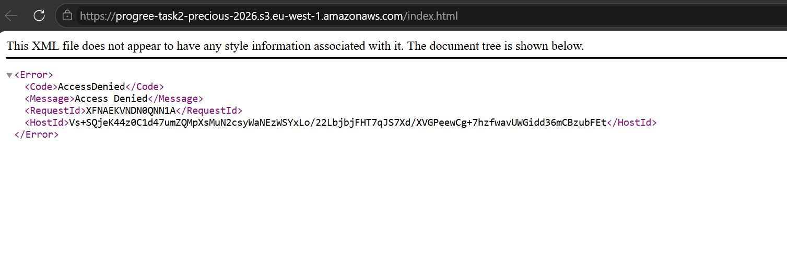
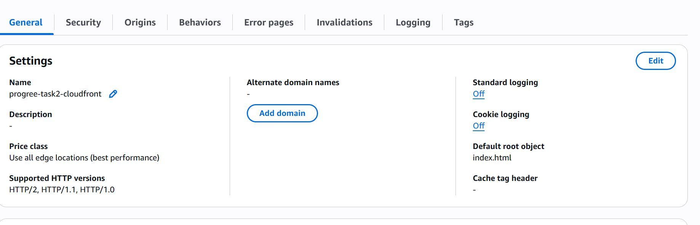
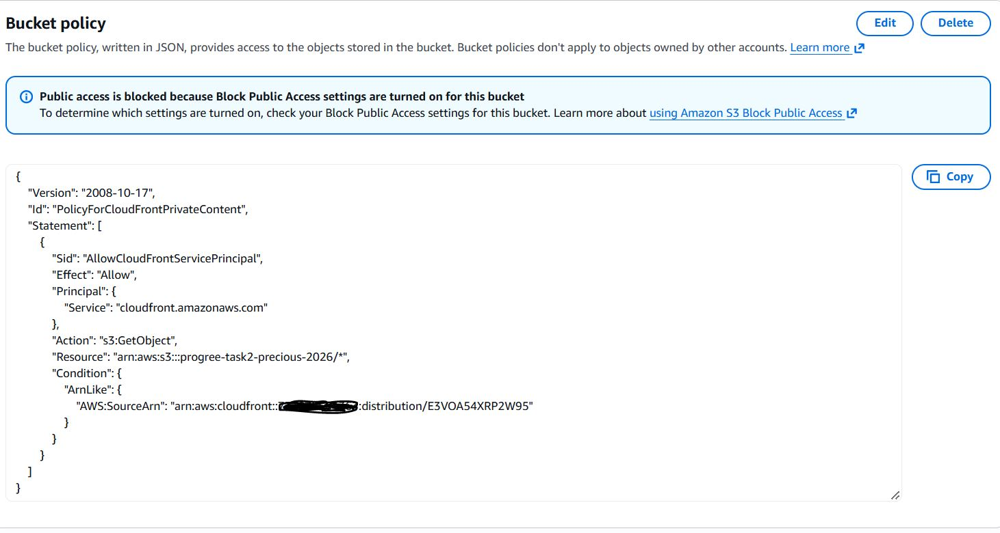
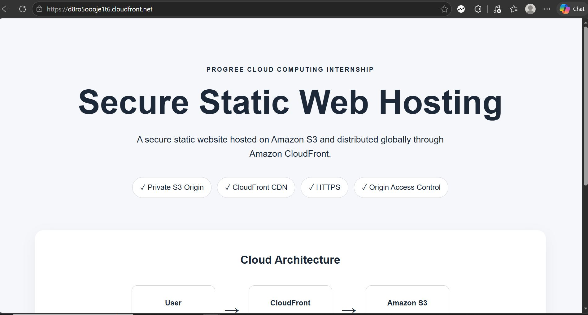
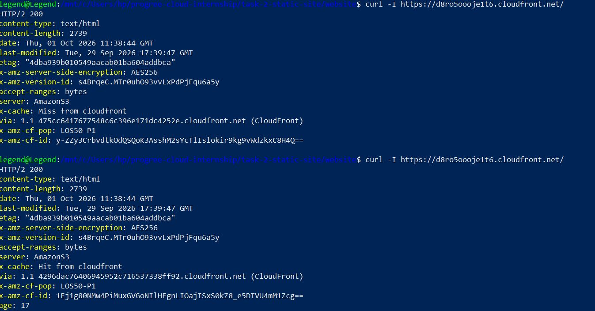
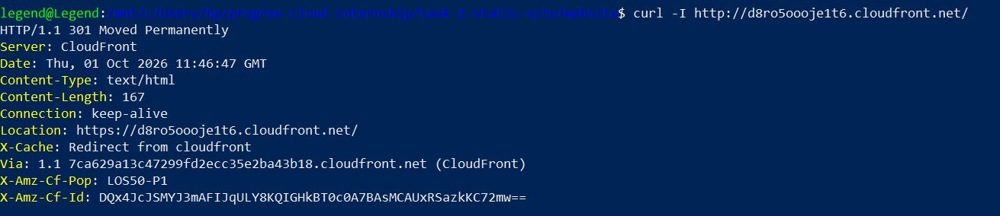

# Progree Cloud Computing Internship — Task 2

## Secure Static Web Hosting & CDN Deployment

This project was completed as **Task 2 of the Progree Cloud Computing Internship**.

The objective was to deploy a static web asset using cloud object storage while implementing secure access controls, CDN-based content delivery, and SSL/TLS encryption.

The implementation uses **Amazon S3** as a private object-storage origin and **Amazon CloudFront** as the public Content Delivery Network (CDN).

---

## Task Objective

The official task required:

> Deploy a globally available static web asset inside an object storage network. Provision an isolated cloud object storage container instance, configure granular public access restrictions via JSON IAM policies, configure custom domain mapping, and route traffic through a Content Delivery Network (CDN) cache layer with SSL encryption.

---

## Architecture

The implemented architecture is:

```text
                         Internet User
                              |
                              | HTTPS
                              v
                     +------------------+
                     | Amazon CloudFront|
                     |       CDN        |
                     +---------+--------+
                               |
                               | Authorized origin request
                               | Private S3 access
                               v
                     +------------------+
                     |    Amazon S3     |
                     |  Private Bucket  |
                     +------------------+
                         |            |
                         |            |
                    index.html    style.css


Direct Internet Access
          |
          X
     Amazon S3
   Access Denied
```

The S3 bucket is not publicly accessible. Users retrieve the website through CloudFront rather than directly from Amazon S3.

---

## AWS Services Used

| Service | Purpose |
|---|---|
| Amazon S3 | Stores the static website files |
| Amazon CloudFront | Provides CDN distribution and public website delivery |
| CloudFront Origin Access Control | Allows CloudFront to securely access the private S3 origin |
| S3 Bucket Policy | Grants restricted read access to the CloudFront distribution |
| HTTPS/TLS | Encrypts traffic between website visitors and CloudFront |

---

## Project Structure

```text
task-2-static-site/
├── README.md
│
├── policies/
│   └── cloudfront-s3-policy.json
│
├── screenshots/
│   ├── 01-s3-bucket-objects.JPG
│   ├── 02-s3-bucket-properties.JPG
│   ├── 03-s3-bucket-access.JPG
│   ├── 04-s3-bucket-object-ownership.JPG
│   ├── 05-s3-direct-access-denied.JPG
│   ├── 06-cloudfront-distribution.JPG
│   ├── 07-cloudfront-https-website.JPG
│   ├── 08-s3-cloudfront-policy.JPG
│   ├── 09-cloudfront-cache-test.JPG
│   └── 10-http-https-redirect.JPG
│
└── website/
    ├── index.html
    └── style.css
```

---

# Implementation

## 1. Static Website Development

A simple responsive static website was created using:

- HTML5
- CSS3

The website presents information about the cloud architecture used for the project.

The application was first tested locally using Python's built-in HTTP server:

```bash
cd website
python3 -m http.server 8000
```

The website was then accessed locally through:

```text
http://localhost:8000
```

This allowed the website to be verified before deploying it to AWS.

---

## 2. Amazon S3 Bucket

A general-purpose Amazon S3 bucket was provisioned:

```text
progree-task2-precious-2026
```

Region:

```text
Europe (Ireland)
eu-west-1
```

The following website assets were uploaded to the root of the bucket:

```text
index.html
style.css
```

### Evidence



---

## 3. S3 Configuration

The S3 bucket was configured as a private origin rather than a publicly accessible website bucket.

Bucket versioning was enabled to provide object version history and additional protection against accidental overwrites.

### Evidence



---

# Security Configuration

## 4. S3 Block Public Access

Amazon S3 Block Public Access was kept enabled.

This prevents anonymous users on the internet from directly retrieving objects from the bucket.

The architecture therefore does **not** rely on making the S3 bucket publicly readable.

### Evidence



---

## 5. S3 Object Ownership

S3 Object Ownership was configured using:

```text
Bucket owner enforced
ACLs disabled
```

Access to the objects is therefore managed using policies instead of legacy Access Control Lists (ACLs).

### Evidence



---

## 6. Direct S3 Access Test

Before configuring CloudFront, the S3 object URL for `index.html` was accessed directly.

The request returned:

```xml
<Error>
    <Code>AccessDenied</Code>
    <Message>Access Denied</Message>
</Error>
```

This was an expected result.

It demonstrated that the website files existed in S3 but could not be accessed anonymously from the internet.

### Evidence



---

# CloudFront CDN

## 7. CloudFront Distribution

An Amazon CloudFront distribution was created with the private S3 bucket as its origin.

Distribution name:

```text
progree-task2-cloudfront
```

CloudFront domain:

```text
d8ro5oooje1t6.cloudfront.net
```

The default root object was configured as:

```text
index.html
```

This allows requests to:

```text
https://d8ro5oooje1t6.cloudfront.net/
```

to automatically retrieve `index.html`.

Origin Shield and AWS WAF were not enabled because they were unnecessary for the requirements of this internship project and the deployment was designed to remain within a zero-cost learning environment.

### Evidence



---

## 8. Private Origin Access

CloudFront was granted controlled access to the private S3 origin.

Instead of allowing public S3 access, CloudFront is authorized to retrieve objects from the bucket.

The access relationship is:

```text
Internet
    |
    | HTTPS
    v
CloudFront
    |
    | Authorized request
    v
Private S3
```

while:

```text
Internet
    |
    X
Private S3
```

remains blocked.

---

# Granular JSON Access Policy

## 9. S3 Bucket Policy

A restricted S3 bucket policy allows the CloudFront service to perform:

```text
s3:GetObject
```

against objects stored in:

```text
arn:aws:s3:::progree-task2-precious-2026/*
```

The policy also contains a condition restricting access to the intended CloudFront distribution.

A sanitized version of the policy is stored at:

```text
policies/cloudfront-s3-policy.json
```

Example:

```json
{
    "Version": "2008-10-17",
    "Id": "PolicyForCloudFrontPrivateContent",
    "Statement": [
        {
            "Sid": "AllowCloudFrontServicePrincipal",
            "Effect": "Allow",
            "Principal": {
                "Service": "cloudfront.amazonaws.com"
            },
            "Action": "s3:GetObject",
            "Resource": "arn:aws:s3:::progree-task2-precious-2026/*",
            "Condition": {
                "ArnLike": {
                    "AWS:SourceArn": "arn:aws:cloudfront::<ACCOUNT-ID>:distribution/E3VOA54XRP2W95"
                }
            }
        }
    ]
}
```

The AWS account ID has intentionally been removed from the repository version.

The policy follows the principle of least privilege: CloudFront receives permission to read the website objects but is not granted permissions such as deleting or uploading objects.

### Evidence



---

# HTTPS Deployment

## 10. Website Through CloudFront

After the CloudFront distribution finished deploying, the website was successfully accessed using HTTPS.

```text
https://d8ro5oooje1t6.cloudfront.net/
```

The S3 bucket remained private while CloudFront successfully retrieved and delivered the website.

### Evidence



---

# CDN Verification

## 11. CloudFront Cache Test

CloudFront caching was tested from the command line using:

```bash
curl -I https://d8ro5oooje1t6.cloudfront.net/
```

The first request returned:

```text
HTTP/2 200
x-cache: Miss from cloudfront
```

This indicated that CloudFront did not have the requested object cached at that edge location and retrieved it from the S3 origin.

The same request was immediately executed again:

```bash
curl -I https://d8ro5oooje1t6.cloudfront.net/
```

The second response returned:

```text
HTTP/2 200
x-cache: Hit from cloudfront
age: 17
```

This confirmed that CloudFront had cached the object and subsequently served it from its cache.

The response was handled by the CloudFront Point of Presence identified in the test as:

```text
LOS50-P1
```

This test demonstrates the practical operation of the CDN rather than relying only on the CloudFront console configuration.

### Evidence



---

# HTTP to HTTPS Verification

## 12. HTTPS Enforcement Test

An unencrypted HTTP request was deliberately made using:

```bash
curl -I http://d8ro5oooje1t6.cloudfront.net/
```

CloudFront responded with:

```text
HTTP/1.1 301 Moved Permanently
Location: https://d8ro5oooje1t6.cloudfront.net/
X-Cache: Redirect from cloudfront
```

This demonstrates that HTTP requests are automatically redirected to the HTTPS endpoint.

The result verifies that visitors are directed to an encrypted TLS connection when accessing the website through CloudFront.

### Evidence



---

# Validation Results

The deployment was tested rather than relying solely on configuration settings.

| Test | Expected Result | Actual Result |
|---|---|---|
| Local website | Website loads | PASS |
| Direct S3 object access | Access denied | PASS |
| CloudFront root URL | Website loads | PASS |
| HTTPS request | HTTP 200 | PASS |
| Initial CDN request | Cache miss | PASS |
| Repeated CDN request | Cache hit | PASS |
| HTTP request | Redirect to HTTPS | PASS |
| S3 remains private | Direct access denied | PASS |

---

# Custom Domain Requirement

The original task also specifies custom domain mapping.

A custom domain was **not deployed** for this implementation because no registered domain was available and the project was completed under a strict zero-cost constraint.

The default CloudFront domain:

```text
d8ro5oooje1t6.cloudfront.net
```

is therefore used for the deployed website.

This CloudFront address provides HTTPS but is **not being represented as a custom domain**.

In a production environment with an owned domain, the remaining process would involve:

1. Creating a DNS record for a domain or subdomain.
2. Requesting an appropriate TLS certificate.
3. Validating domain ownership.
4. Adding the custom hostname to the CloudFront distribution.
5. Pointing the DNS record toward the CloudFront distribution.
6. Testing HTTPS through the custom hostname.

This limitation is documented explicitly rather than representing an unimplemented custom-domain configuration as completed.

---

# Security Summary

The deployment follows several important cloud security practices:

- S3 Block Public Access remains enabled.
- S3 ACLs are disabled.
- The S3 bucket is not exposed as a public website.
- CloudFront acts as the public entry point.
- S3 access is restricted through a resource policy.
- CloudFront receives read-only `s3:GetObject` permission.
- Access is restricted to the intended CloudFront distribution.
- HTTP requests are redirected to HTTPS.
- AWS account information is removed from public documentation.

---

# Cost Considerations

This project was designed around a **zero-cost learning constraint**.

To minimize unnecessary AWS charges:

- AWS WAF was not enabled.
- Origin Shield was not enabled.
- No domain was purchased.
- No Route 53 hosted zone was created.
- No unnecessary edge-compute services were deployed.
- The project uses only the resources necessary to demonstrate the internship requirements.

Cloud resources should still be monitored because pay-as-you-go AWS services can incur charges when usage exceeds applicable free allowances.

---

# Key Lessons Learned

This task provided practical experience with:

- Amazon S3 object storage
- S3 bucket security
- S3 Block Public Access
- Object Ownership and ACL configuration
- JSON resource policies
- Principle of least privilege
- Amazon CloudFront
- Content Delivery Networks
- Private cloud origins
- CloudFront origin access
- CDN edge caching
- HTTP response headers
- Cache HIT and MISS behavior
- HTTPS/TLS
- HTTP-to-HTTPS redirection
- Cloud architecture testing
- AWS cost awareness
- Technical evidence collection

A particularly important lesson from this project is that **secure static hosting does not require making an S3 bucket public**.

Instead, the storage layer can remain private while CloudFront provides the controlled public delivery layer.

---

# Final Result

The final deployed request path is:

```text
User
  |
  | HTTPS
  v
Amazon CloudFront
  |
  | Restricted origin access
  v
Private Amazon S3
  |
  +-- index.html
  |
  +-- style.css
```

Direct anonymous access to the S3 objects remains blocked.

CloudFront successfully provides:

- Public website delivery
- CDN caching
- HTTPS encryption
- HTTP-to-HTTPS redirection
- Controlled access to the private S3 origin

---

## Internship

**Program:** Progree Cloud Computing Internship  
**Task:** Task 2 — Secure Static Web Hosting & CDN Deployment  
**Cloud Provider:** Amazon Web Services (AWS)
